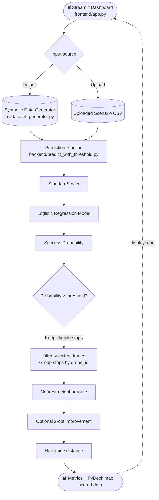
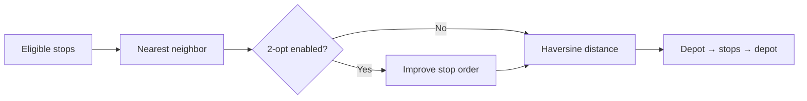

# Drone Optimizer V2.0
### Machine-Learning-Assisted Delivery Safety Filtering and Multi-Drone Route Optimization

Drone Optimizer V2.0 is a Python application that estimates delivery success probability from operational and weather-related features, filters delivery stops using a configurable probability threshold, and calculates a depot-to-delivery route for each selected drone. A Streamlit dashboard presents the summary, per-drone routes, and the input dataset on an interactive map.

> **Scope note:** The repository contains both `Drone_Optimizer V2.0/` and an older `Drone_Optimizer/` implementation. This README documents the **V2.0 Streamlit workflow** as the primary application. The older folder has a separate Flask API and Streamlit frontend; its behavior and setup are not interchangeable with V2.0.

## Contents

- [Visual architecture](#visual-architecture)
- [Execution flow](#execution-flow)
- [Project structure](#project-structure)
- [Run locally](#run-locally)
- [CSV input](#csv-input)
- [Dashboard outputs](#dashboard-outputs)
- [Implementation notes](#implementation-notes)


## What it does

<details>
<summary><strong>Core capabilities</strong></summary>

| Input | Processing | Output |
|---|---|---|
| Generated scenario or CSV | Logistic Regression scoring | `success_probability` per stop |
| Drone and depot coordinates | Threshold filtering | Eligible delivery stops |
| Eligible stops grouped by drone | Nearest neighbor + optional 2-opt | Ordered depot-to-depot routes |
| Route coordinates | Haversine distance | Route distance and map visualization |

</details>


## Execution flow


## Visual architecture



### Component map

| Component | Responsibility |
|---|---|
| `frontend/app.py` | Dashboard controls, metrics, map and dataset display |
| `backend/api_pipeline.py` | Connects prediction, drone filtering and route solving |
| `backend/predict_with_threshold.py` | Loads the saved scaler/model and filters stops |
| `ml/dataset_generator.py` | Creates synthetic drone delivery scenarios |
| `ml/train_logistic_model.py` | Trains and exports the Logistic Regression model |
| `ml/tsp/tsp.py` | Stop ordering, 2-opt and geographic distance calculation |


## Machine-learning details

```text
5 features
    ↓
StandardScaler
    ↓
Logistic Regression
    ↓
success_probability
    ↓
Keep if probability ≥ selected threshold
```

**Features:** `distance_km` · `payload_kg` · `wind_speed_mps` · `rain_mm` · `battery_before`

The training script generates 5,000 synthetic samples and creates labels from a formula-based risk score with noise. Its evaluation therefore measures performance against synthetic labels, not verified real-world delivery outcomes.

Model artifacts expected by the app:

```text
ml/
├── logistic_model_v2.joblib
└── scaler_v2.joblib
```


## Route optimization



- **Nearest neighbor:** chooses the nearest unvisited stop at each step.
- **2-opt:** tries reversing route segments to shorten the tour.
- **Haversine:** estimates great-circle distance using an Earth radius of 6,371 km.

This is a heuristic; it does not guarantee the globally shortest route or model battery consumption, no-fly zones, airspace restrictions, or time windows.


## Project structure

```text
Drone_Optimizer-master/
├── README.md
├── Drone_Optimizer V2.0/
│   ├── frontend/
│   │   ├── app.py                     # Main Streamlit dashboard
│   │   └── drone.png
│   ├── backend/
│   │   ├── api_pipeline.py             # End-to-end prediction + routing pipeline
│   │   ├── predict_with_threshold.py   # Loads model/scaler and filters stops
│   │   ├── run_tsp_per_drone.py        # Command-line multi-drone route run
│   │   └── legacy_app.py               # Separate/legacy backend implementation
│   ├── ml/
│   │   ├── dataset_generator.py        # Synthetic scenario generator
│   │   ├── train_logistic_model.py     # Synthetic training and model export
│   │   ├── evaluate_model.py
│   │   ├── generate_research_dataset.py
│   │   ├── logistic_model_v2.joblib    # Saved Logistic Regression model
│   │   ├── scaler_v2.joblib            # Saved feature scaler
│   │   └── tsp/
│   │       └── tsp.py                 # Route ordering and distance calculations
│   ├── Scenarios/
│   │   ├── scenario_normal.csv
│   │   ├── scenario_heavy_rain.csv
│   │   ├── scenario_high_wind.csv
│   │   └── scenario_low_battery.csv
│   ├── routing_comparison/
│   │   └── delivery.json
│   └── requirements.txt
└── Drone_Optimizer/                   # Older, separate implementation
    ├── front_end/
    ├── back_end/
    └── ml/
```

## Requirements

The V2.0 `requirements.txt` lists:

- Flask and Flask-CORS
- pandas and NumPy
- joblib and scikit-learn
- Streamlit
- requests
- PyDeck

The main V2.0 dashboard directly uses Streamlit, pandas, PyDeck, the model artifacts, and the local Python modules. Flask is listed in the shared requirements file but is not required to launch the V2.0 dashboard's main pipeline.

Python 3.10 or newer is a reasonable starting point; use a version supported by the installed scikit-learn and other dependency releases.

## Run locally

Run the commands from the `Drone_Optimizer V2.0` directory.

### 1. Clone or extract the repository

```bash
git clone <repository-url>
cd "Drone_Optimizer-master/Drone_Optimizer V2.0"
```

If you downloaded the ZIP instead, extract it and open a terminal in the `Drone_Optimizer V2.0` folder.

### 2. Create and activate a virtual environment

**Windows PowerShell**
```powershell
py -m venv .venv
.\.venv\Scripts\Activate.ps1
```

**macOS / Linux**
```bash
python3 -m venv .venv
source .venv/bin/activate
```

### 3. Install dependencies

```bash
python -m pip install --upgrade pip
pip install -r requirements.txt
```

### 4. Launch the dashboard

```bash
streamlit run frontend/app.py
```

Streamlit will print a local URL (typically `http://localhost:8501`). Open that URL in your browser.

### Optional: run the per-drone pipeline in the terminal

From the same `Drone_Optimizer V2.0` directory:

```bash
python backend/run_tsp_per_drone.py
```

This script runs the synthetic-data prediction and prints safe-stop counts and route distances for active drones.

### Retraining the model

From `Drone_Optimizer V2.0`, run:

```bash
python ml/train_logistic_model.py
```

After training, move or copy the generated `logistic_model_v2.joblib` and `scaler_v2.joblib` into the `ml/` directory if they were written elsewhere. The application loads both files from `Drone_Optimizer V2.0/ml/`.

## CSV input

For the V2.0 dashboard, an uploaded CSV must contain the following columns with numeric values:

| Column | Meaning |
|---|---|
| `drone_id` | ID of the drone assigned to the stop |
| `depot_lat` | Depot latitude for that drone |
| `depot_lon` | Depot longitude for that drone |
| `lat` | Delivery stop latitude |
| `lon` | Delivery stop longitude |
| `distance_km` | Distance feature used by the model |
| `payload_kg` | Delivery payload in kilograms |
| `wind_speed_mps` | Wind speed in metres per second |
| `rain_mm` | Rain feature in millimetres |
| `battery_before` | Battery level before delivery, represented on the same scale as the training data |

The prediction function specifically requires the five model feature columns listed above. The routing pipeline additionally requires `drone_id`, `depot_lat`, `depot_lon`, `lat`, and `lon`. Use the provided scenario CSVs as examples of the expected schema.

Example command-line-independent workflow: upload a CSV in the sidebar, set the probability threshold, choose drone IDs, and click **Run Optimization**.

## Scenario files

`Scenarios/` includes `scenario_normal.csv`, `scenario_heavy_rain.csv`, `scenario_high_wind.csv`, and `scenario_low_battery.csv`. These are sample inputs, not real-world validation evidence.


## Dashboard outputs

- **Total Drones:** number of unique drone IDs in the full dataset before the selected-drone filter.
- **Active Drones:** number of drone groups with at least one eligible stop after filtering.
- **Total Distance (km):** sum of the calculated route distances for active drones.
- **Safe Stops:** count of eligible stops included in each drone's route.
- **Route Distance (km):** estimated depot-to-depot distance for each active drone.
- **Route Visualization:** colored paths per drone, stop markers, depot markers, and a route-progress slider.
- **Full Dataset:** the input rows plus their calculated `success_probability`.

The dashboard's label “Safe Stops” means stops passing the configured model-probability threshold. It does **not** mean that a stop has been certified as safe for actual flight.

## Implementation notes

- **No live API is needed for V2.0's main dashboard.** It calls the local Python pipeline directly; it does not send requests to a Flask service.
- **Feature order matters.** The prediction module selects model features in a fixed order. Keep the training and inference feature order identical.
- **CSV schema matters.** Missing model columns cause prediction to fail; missing routing columns will also prevent route generation.
- **Model files are required.** The app loads the joblib model and scaler when `backend/predict_with_threshold.py` is imported.
- **Selected drone IDs:** the dashboard offers IDs 1–5. If an uploaded file uses other IDs, those rows may not be included unless the UI is changed.
- **Map coordinate order:** the route solver returns plot coordinates as `[longitude, latitude]`, which is the order expected by the map path.
- **Distance assumptions:** distances use straight-line Haversine calculations and should not be interpreted as measured flight distance.
- **Uploaded files:** use trusted CSV files and validate them before using the results in operational decisions.


